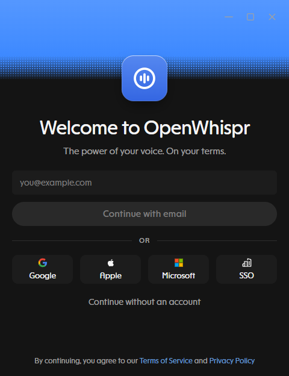
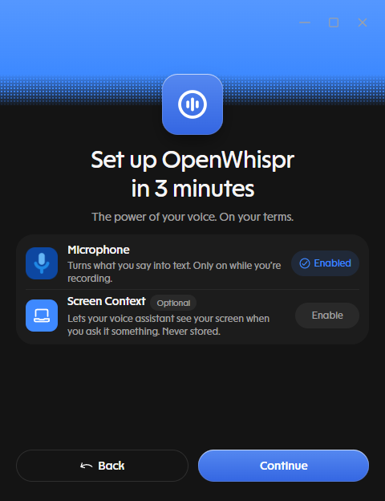
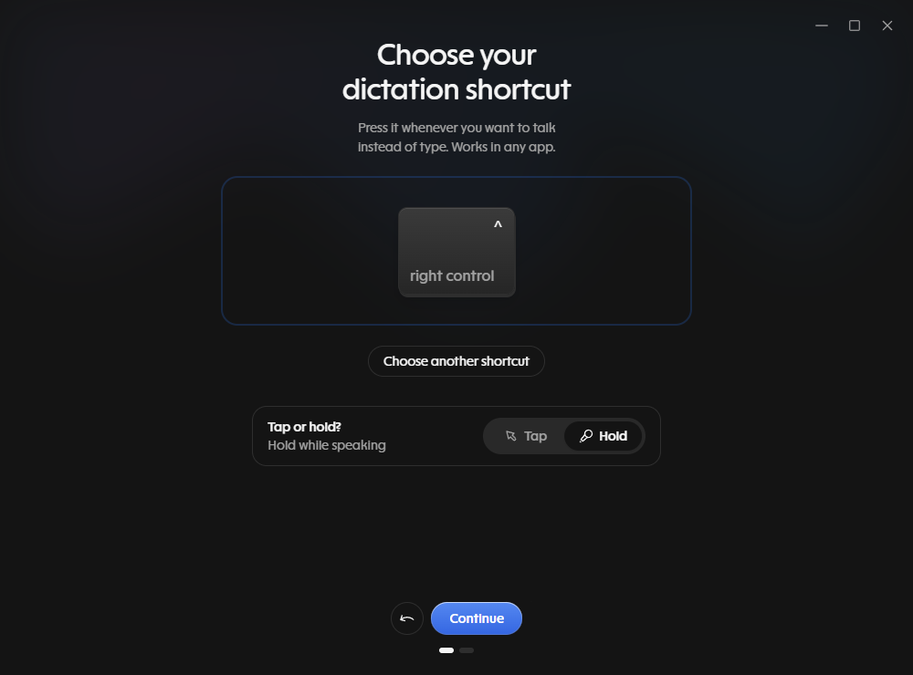
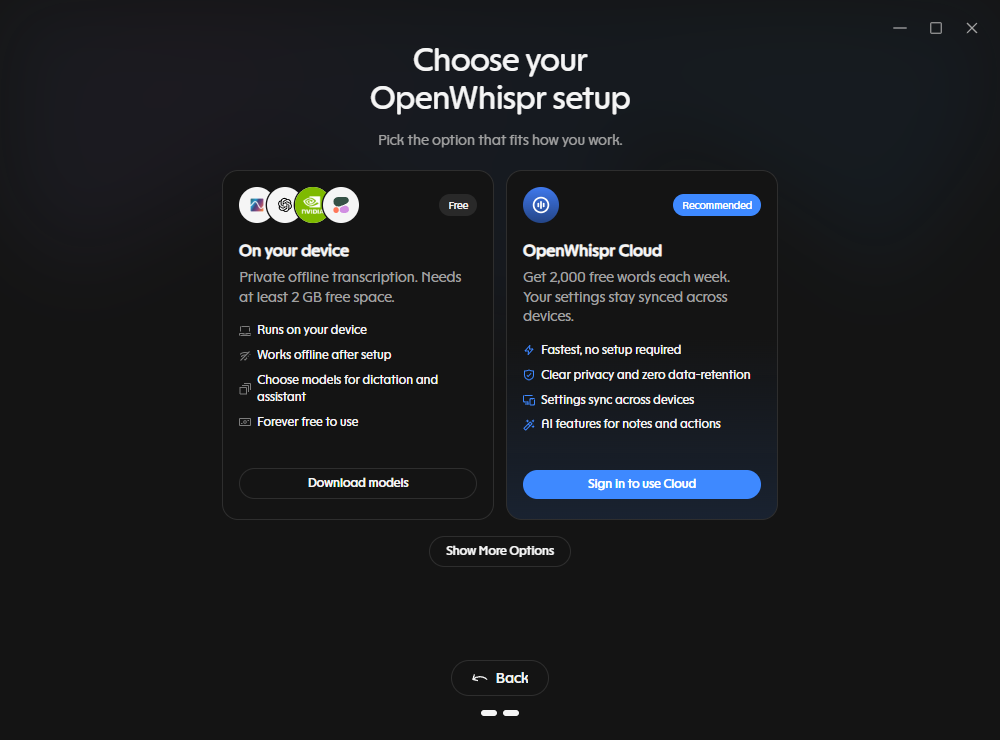
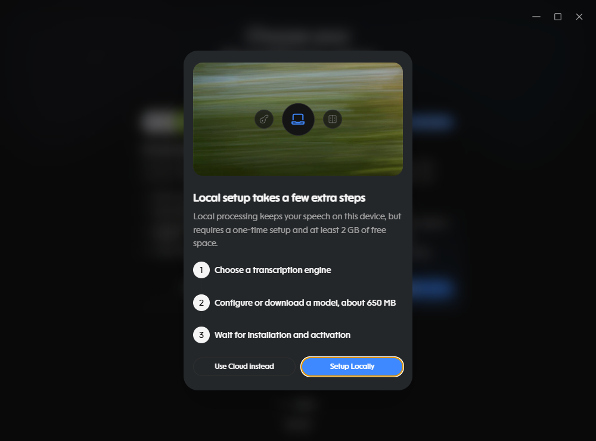
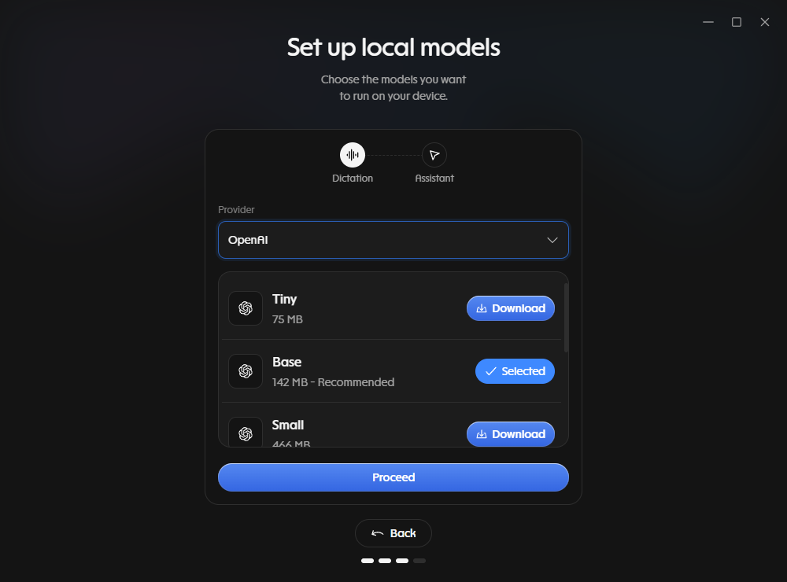
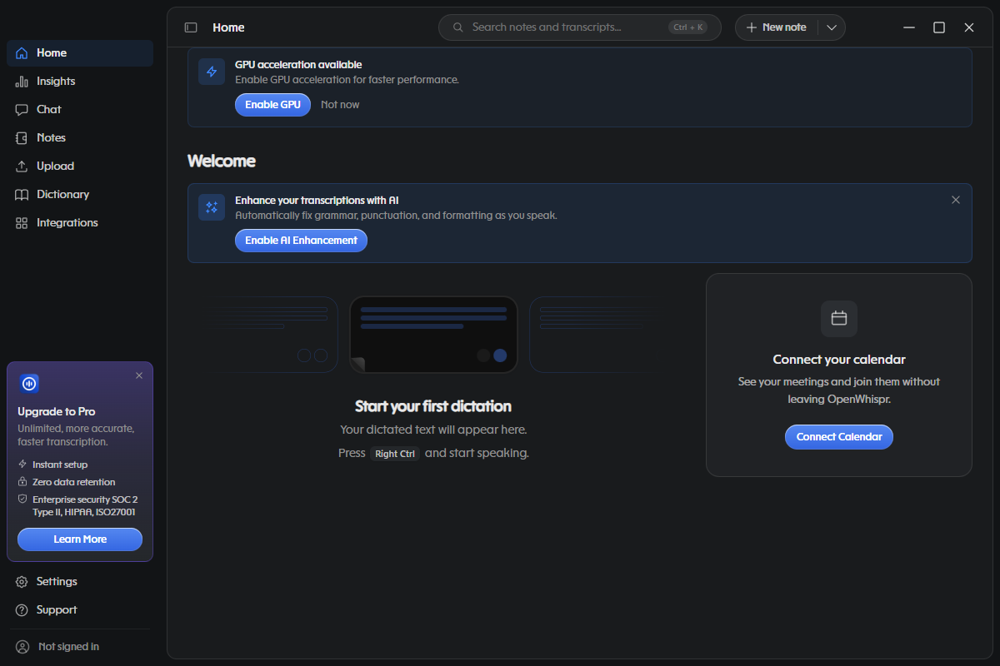
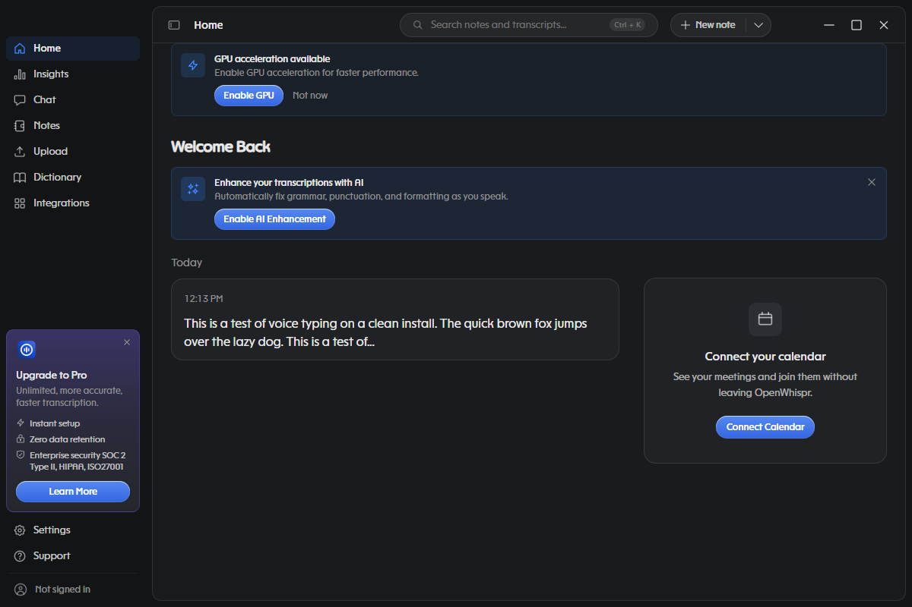
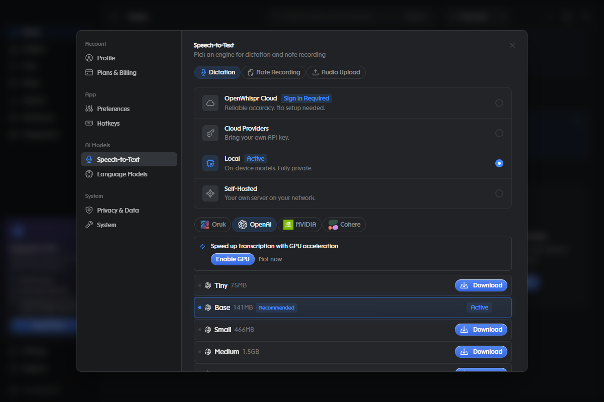
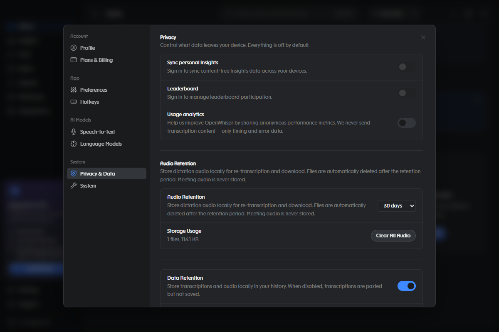

# Free voice typing on your own computer with OpenWhispr

This is an unofficial beginner guide to OpenWhispr, a free app that types what you say.
You press a key, talk, and your words appear wherever your cursor is.
In the setup below, the speech to text runs on your own computer, so the sound of your voice is not sent to a company.

OpenWhispr is made by Gizmo Labs and is open source under the MIT license.
This guide is not made by them and they have not reviewed it.
Their project is at https://github.com/OpenWhispr/openwhispr and their site is https://openwhispr.com.

## Who this is for

This guide is for someone who has never set up a speech to text app.
Every step says what to click, and the screenshots come from a fresh install of the app.
You do not need to know anything about coding, models or the command line.

## What was tested

The steps were checked on 2026-10-18 on Windows 11 with OpenWhispr 1.10.3, which was the newest release on that day.
The app was run from a fresh install with no saved settings, and every screenshot below comes from that run.
Mac and Linux were not tested, so the click paths there may differ.
The installer wizard itself (the window that copies the app onto your disk) was not clicked through, so step 1 only says what to download.
The last part of this guide lists everything that was not verified.

## What you need

- A Windows computer with a working microphone and at least 2 GB of free disk space (the app says so on its setup screen).
- An internet connection for the one-time downloads. The app's setup screen says it "Works offline after setup", but this guide did not test that with the internet turned off.

Settings in this guide means the **Settings** item at the bottom left of the app window.

## Set up

### 1. Download and install the app

1. Open https://openwhispr.com/download and download the Windows version, or open https://github.com/OpenWhispr/openwhispr/releases/latest and download the file that ends in `.exe` (for 1.10.3 it is `OpenWhispr-Setup-1.10.3.exe`, about 254 MB).
2. Run the file and follow the installer.
3. Start OpenWhispr.

### 2. Skip the account

The first screen offers email, Google, Apple, Microsoft and SSO sign in.
Click **Continue without an account** near the bottom. You do not need an account for local dictation.

### 3. Allow the microphone

The next screen is called "Set up OpenWhispr in 3 minutes".
Click **Enable** next to Microphone. The button changes to **Enabled**.
Screen Context is marked Optional and lets the voice assistant see your screen, so you can leave it alone.
Click **Continue**.

### 4. Choose your key

The next screen asks you to choose a dictation shortcut.
Press the key you want to use, or click one of the two suggested buttons, **Right Ctrl** or **Ctrl + Win**.
The screen also asks "Tap or hold?". The default is **Hold**, which means you hold the key while you talk.
Click **Tap** if you would rather press once to start and once to stop, then click **Continue**.

You can change both choices later in Settings, under Hotkeys.

### 5. Choose the on-device option

The next screen shows two cards. The one on the right, OpenWhispr Cloud, is marked Recommended, and it needs you to sign in.
Click **Download models** on the left card, the one labeled Free and On your device.
A box titled "Local setup takes a few extra steps" appears. Click **Setup Locally**.

### 6. Pick a speech model

The app starts on a provider called Oruk, with a model called Orukeet (672 MB), which is marked Recommended.
Orukeet is a different model from Whisper and this guide did not test how accurate it is, so the steps below use Whisper, which is the model most people have heard of.

1. Click the **Provider** menu and choose **OpenAI**. The list shows the Whisper models.
2. Click **Download** next to **Base** (142 MB). It is the small model the app marks Recommended, and it works on most computers.
3. When the button says **Selected**, click **Proceed**.

The next screen asks for an Assistant model, which is a chat model for the voice assistant feature. Dictation does not need it, so click **Skip**.

You land on the Home screen, which looks like this.

### 7. Try it

1. Click inside any place where you can type, such as Notepad.
2. Press your key and say a sentence. A small round icon appears at the bottom right of the screen while the app listens.
3. Press the key again if you chose Tap, or let go if you chose Hold. After a moment the words appear.

Every dictation is also listed on the Home screen, so you can read it there if nothing was typed.

## Which model to pick

The app shows sizes next to each Whisper model. Bigger models make fewer mistakes, mostly on names and unusual words, and they take longer to run.
Settings has the same list, under Speech-to-Text, then Local, then the OpenAI tab.

| Model in the app | Download size | Time to type a 7 second sentence, CPU only, 2 threads | 4 threads |
|---|---|---|---|
| Tiny | 75 MB | 0.57 s | 0.36 s |
| Base | 142 MB | 1.39 s | 0.56 s |
| Small | 466 MB | 3.87 s | 2.14 s |
| Medium | 1.5 GB | 10.64 s | 5.77 s |
| Large (large-v3) | 3 GB | 31.83 s | 12.15 s |
| Turbo (large-v3-turbo) | 1.6 GB | 17.44 s | 9.61 s |

How these numbers were measured: a 7 second clip made with the Windows text to speech voice, decoded five times per setting by the speech server that comes with OpenWhispr 1.10.3, with only the processor used, on a Ryzen 9 9950X3D limited to 2 or 4 threads.
That processor is much faster than a laptop, so read the numbers as the best case, and expect your own computer to be slower.
Medium, Large and Turbo take longer than the sentence lasts when only the processor is used, so run them only with a graphics card, as explained below.
Turbo is not much faster than Large on a processor, and it only pulls ahead on a graphics card.

### Using a graphics card

If you have an Nvidia graphics card, open Settings, then Speech-to-Text, and click **Enable GPU** under the model list.
The app downloaded about 1 GB of extra files when this was tried. Without it, the app uses only the processor.
The README of OpenWhispr says AMD and Intel cards are supported too, but that was not tried here.
On a Windows 11 desktop with an RTX 5090, the Large model took a median of 0.3 seconds to transcribe a 17 to 25 second dictation after it had loaded. This number comes from an older OpenWhispr version (1.7.6), and no other graphics card was tested.

## What stays on your computer

With a local model selected, your speech is turned into text by a program on your computer and the audio is not uploaded.
The app does connect to the internet for other reasons. While it was being set up, the connections seen were to GitHub and to Amazon CloudFront, which is the kind of address a model download or an update check uses.
The app also stores things on your disk by default, and the Privacy and Data page in Settings is where you change that.

- Audio retention is set to 30 days out of the box, so each dictation's audio is saved on your disk. A file was found in the app's data folder after one test dictation.
- Data Retention is on and Transcript Retention is Forever, so your dictated text stays in the Home list until you delete it.
- Usage analytics, Leaderboard and syncing are off.

If you do not want any of that saved, set Audio Retention to Disabled and turn off Data Retention.

## Troubleshooting

**Nothing appears where I typed.**
Open Settings, then Preferences, then Clipboard.
Automatic pasting is on by default. The app describes **Keep transcription in clipboard** as keeping the dictated text in your clipboard so you can paste it manually, so turn that on and press Ctrl+V yourself.
Some programs refuse pasted text from other apps, and this guide did not test which ones.

**The message "No audio detected" appears.**
The app gives this message when a recording has no sound in it. Check that the right microphone is chosen in Settings, then Preferences, then Microphone.

**The wrong words appear, or words I did not say.**
Try a bigger model first.
Whisper is known to make up phrases when a recording is mostly silence or noise, and this was not reproduced here.
Settings, then Speech-to-Text, has a switch named Silero VAD for Dictation, which is off by default. It cuts out the quiet parts before the model sees them.
Its effect was not tested for this guide. A separate test of 246 recorded dictations with the Large model found that on clips of 12 seconds or less, 75 words were lost with it on and 24 with it off, so try it only if invented words are a real problem for you.

**My key does nothing.**
Another program may be using the same key. Open Settings, then Hotkeys, and click the key to choose a different one.

**I want it to start with Windows.**
It does not by default. Settings, then Preferences, then Startup has a **Launch at login** switch.

**I want to remove it.**
Use Windows Settings, then Apps, then Installed apps, and uninstall OpenWhispr. Downloaded models stay in a folder named `.cache\openwhispr` inside your user folder, and you can delete that folder yourself.

## What was not verified

- The installer wizard screens, uninstalling through Windows Settings, and a Mac or Linux install.
- Dictation with the internet turned off.
- Pasting into other programs. The test confirmed that recording and transcribing work and that the text is saved to Home, but the final step of typing into another program was not run on this fresh install.
- Accuracy of any model. The speed numbers above measure time only.
- Any graphics card other than one Nvidia RTX 5090, and any real laptop.
- The statement "no data collection" on the OpenWhispr site. This guide only looked at the app's own settings and at which servers it connected to for a short time.

## Credits and license

All credit for the app goes to the OpenWhispr project and its contributors, and for the speech model to OpenAI Whisper and the whisper.cpp project.
This guide is a separate, unofficial write-up. The text and screenshots in it are released under the MIT license in the LICENSE file.
OpenWhispr is a trademark of its owners, and the screenshots show their app.
